<p align="center">
  <picture>
    <source media="(prefers-color-scheme: dark)" srcset="preview/hero-dark.jpg">
    <source media="(prefers-color-scheme: light)" srcset="preview/hero-light.jpg">
    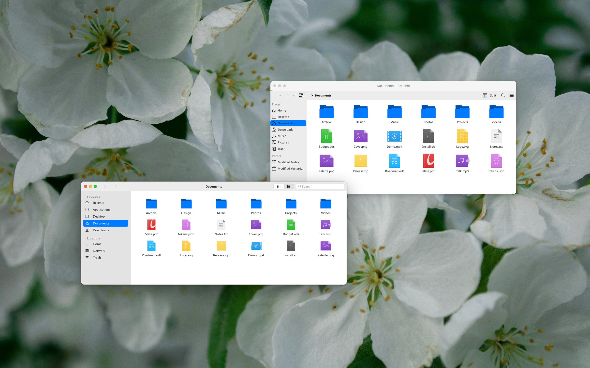
  </picture>
</p>

<h1 align="center">Slate</h1>

<p align="center">
  A compact, modern macOS look for Linux.<br>
  One set of design tokens. Identical on GNOME and KDE Plasma. Light and Dark.
</p>

Slate gives GTK and Qt apps the same quiet, tight look: unified title bars,
traffic-light window buttons, slightly rounded corners, and short, smooth
motion. It was made first for CachyOS, and it works on any distribution that
runs GNOME or KDE Plasma 6.

## Features

- **One look on two desktops.** GTK3, GTK4, libadwaita, Qt (Kvantum) and the
  KWin title bar all come from one file, `tokens.json`. They cannot drift apart.
- **Unified title bars.** The title bar and the toolbar share one surface, as on macOS.
- **Traffic lights on the left.** Red, yellow and green buttons in GTK and in
  KDE (Aurorae). The glyph shows when you hover.
- **Compact.** 13 px text, 24 px controls, 38 px header bars, 12 px window corners.
- **Light and Dark.** Two variants, `Slate-Light` and `Slate-Dark`, with the system blue accent.
- **Motion.** A KWin setup with scale open and close, a magic lamp (genie)
  minimize, blur, and a faster animation speed.
- **No sudo.** Everything installs into your home folder, and `--uninstall`
  puts your old settings back.

## Preview

| GTK4 / libadwaita | GTK3 |
| :---: | :---: |
| 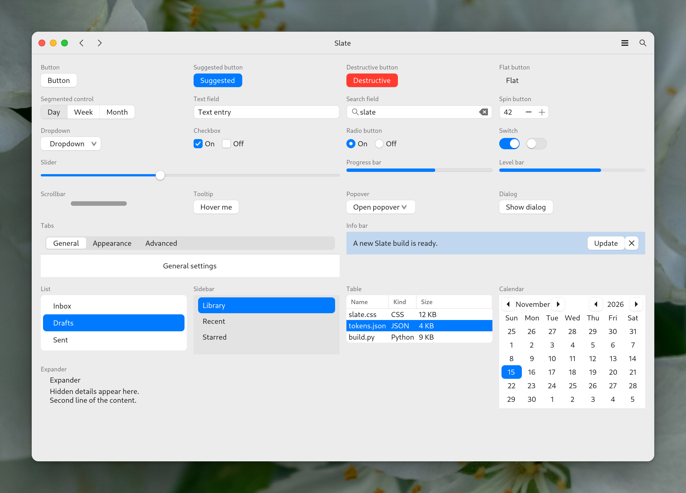 | 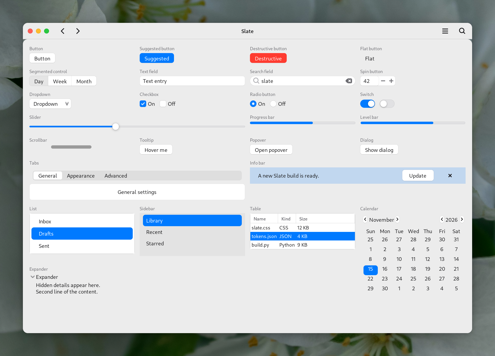 |
| 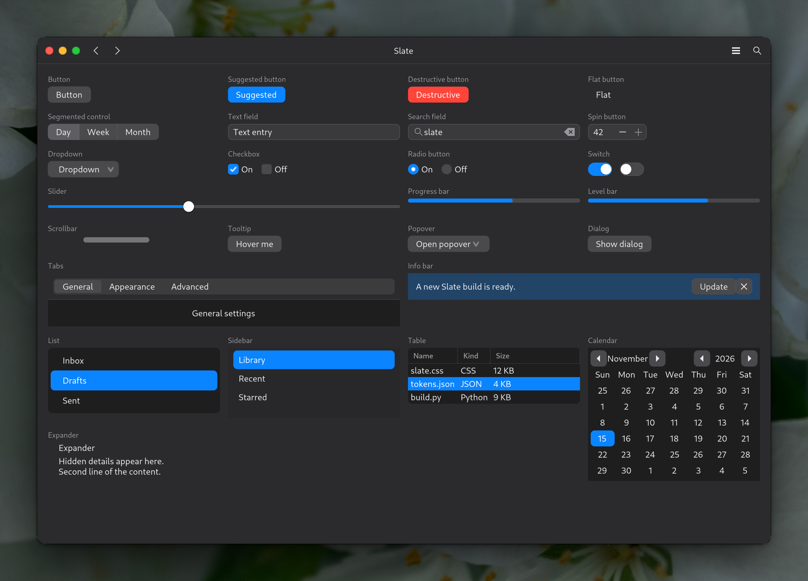 | 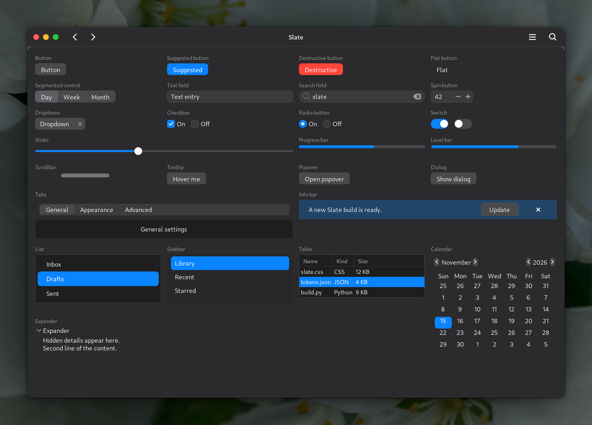 |

| Qt / Kvantum |
| :---: |
| 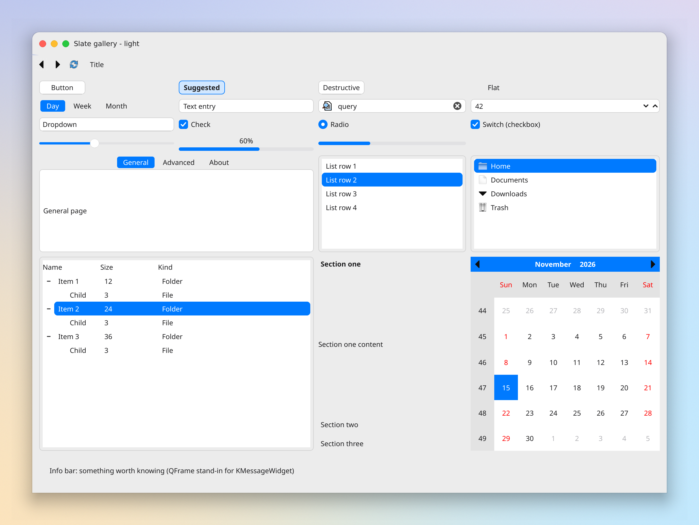 |
| 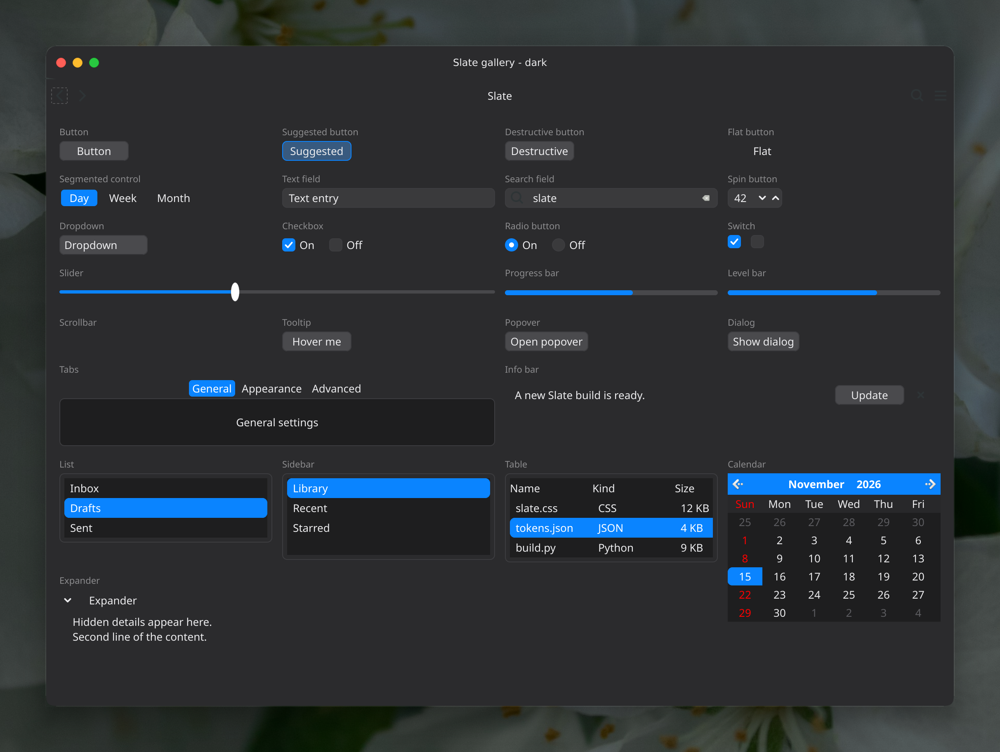 |

| KDE window decoration | Plasma desktop |
| :---: | :---: |
| 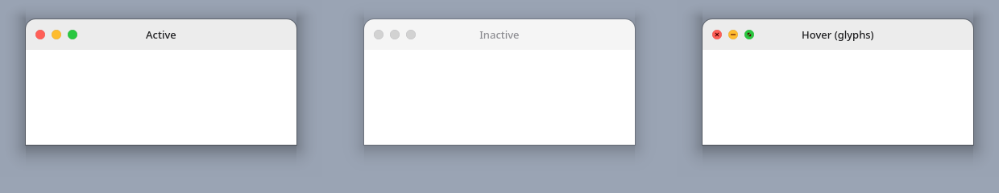 | 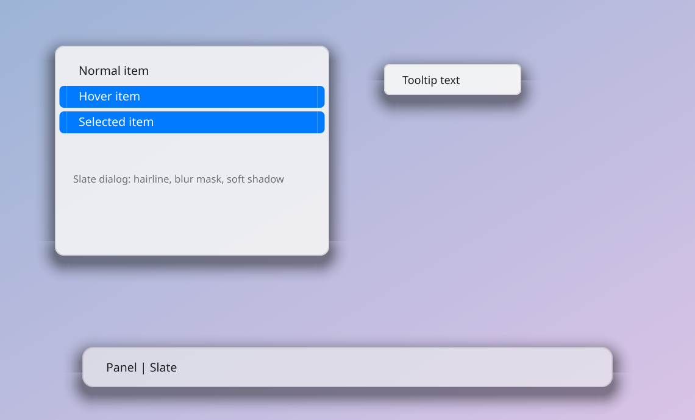 |
| 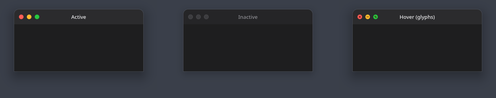 | 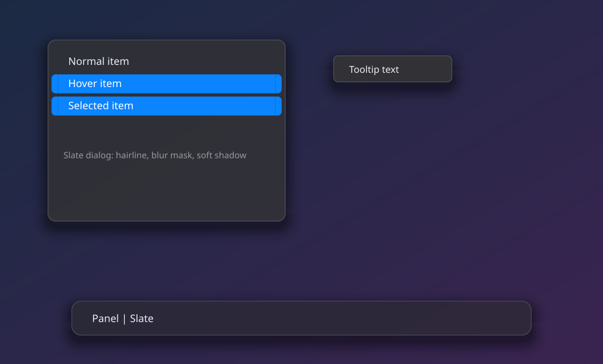 |

## Supported desktops

| Desktop | Part | What it covers |
| --- | --- | --- |
| GNOME 46 and newer | GTK 3.24 theme (`gtk-3.0`) | GTK3 apps: headerbars, menus, controls, window buttons |
| GNOME 46 and newer | GTK 4 theme (`gtk-4.0`) | GTK4 apps, and libadwaita apps through `~/.config/gtk-4.0` |
| KDE Plasma 6.x | Kvantum theme | Qt5 and Qt6 widgets: buttons, menus, scrollbars, tabs |
| KDE Plasma 6.x | Aurorae decoration (KWin) | Title bars with traffic lights |
| KDE Plasma 6.x | Color scheme | KDE colors for apps that ignore Kvantum |
| KDE Plasma 6.x | Plasma desktop theme | Panel, task manager, popups, widgets |
| KDE Plasma 6.x | Global Theme (look and feel) | Applies all of the above in one click |
| KDE Plasma 6.x | KWin motion setup | Effects and animation speed, set by `scripts/apply-kde.sh` |

Other GTK desktops (XFCE, Cinnamon, MATE) can use the GTK3 and GTK4 themes. They
are not tested.

## Requirements

- Python 3 (`install.sh` runs `build.py`)
- For Qt apps on KDE: Kvantum
- Recommended font: Inter
- KDE only: `kwriteconfig6` and `qdbus6` (part of KDE Frameworks 6, already on Plasma)

GTK themes need no engine. GTK3 and GTK4 read plain CSS.

```sh
# Arch, CachyOS, Manjaro, EndeavourOS
sudo pacman -S kvantum inter-font

# Debian, Ubuntu
sudo apt install qt6-style-kvantum qt5-style-kvantum fonts-inter

# Fedora
sudo dnf install kvantum rsms-inter-fonts
```

On GNOME you can skip Kvantum. It only styles Qt apps.

## Installation

```sh
git clone https://github.com/surajmandalcell/slate-theme.git
cd slate-theme
./install.sh                 # build and install both variants
./install.sh --apply dark    # also switch to Slate-Dark (or: light)
```

`install.sh` builds the themes into `dist/`, then copies them to:

| Part | Folder |
| --- | --- |
| GTK3 and GTK4 | `~/.themes` and `~/.local/share/themes` |
| Kvantum | `~/.config/Kvantum` |
| Aurorae | `~/.local/share/aurorae/themes` |
| Color scheme | `~/.local/share/color-schemes` |
| Plasma desktop theme | `~/.local/share/plasma/desktoptheme` |
| Global Theme | `~/.local/share/plasma/look-and-feel` |

### Options

| Flag | What it does |
| --- | --- |
| (none) | Build and install `Slate-Light` and `Slate-Dark`. Does not change your active theme. |
| `--apply light` or `--apply dark` | Also make that variant active. Writes the GTK `settings.ini` files, copies the theme to `~/.config/gtk-4.0` for libadwaita, sets gsettings (GNOME), and runs `scripts/apply-kde.sh` (KDE). |
| `--uninstall` | Remove the Slate folders and restore the files and gsettings values that `--apply` saved. |
| `--prefix DIR` | Use `DIR` as the home folder, for testing. gsettings and the KDE apply script are skipped. |
| `-h`, `--help` | Show the help text. |

`--apply` saves every file it changes as `*.bak-slate` (or a `.slate-new` marker
when the file did not exist), and `--uninstall` puts them back. It sets the
window button layout to `close,minimize,maximize:` (buttons on the left).

### Uninstall

```sh
./install.sh --uninstall
```

## Manual setup

Use these steps if you installed without `--apply`, or want to pick the parts yourself.

### KDE Plasma

1. System Settings > Appearance > **Global Theme**: pick `Slate-Light` or
   `Slate-Dark`. This sets most of the next steps for you.
2. System Settings > Appearance > **Colors**: pick the Slate scheme.
3. System Settings > Appearance > **Application Style**: choose
   **Kvantum**. Then open Kvantum Manager > Change/Delete Theme, select
   `Slate-Light` or `Slate-Dark`, and press Use this theme.
4. System Settings > Appearance > **Window Decorations**: pick the Slate
   decoration. Open Configure Titlebar Buttons and put Close, Minimize and
   Maximize on the left, in that order. Set the border size to None.
5. System Settings > Appearance > **Plasma Style**: pick the Slate theme.
6. System Settings > Appearance > **Fonts**: set Inter, 10 pt.
7. System Settings > Workspace Behavior > **Desktop Effects**: turn on the
   effects in the [Motion](#motion) section.

### GNOME

Install the themes, then set them in a terminal:

```sh
gsettings set org.gnome.desktop.interface gtk-theme 'Slate-Dark'
gsettings set org.gnome.desktop.interface color-scheme 'prefer-dark'
gsettings set org.gnome.desktop.wm.preferences button-layout 'close,minimize,maximize:'
```

For Light, use `Slate-Light` and `prefer-light`. You can also pick the
theme in **GNOME Tweaks** > Appearance > Legacy Applications, and the layout in
Tweaks > Window Titlebars.

**libadwaita apps** (Files, Settings, and most new GNOME apps) ignore the theme
name. They read `~/.config/gtk-4.0/gtk.css`. Copy the variant you want there:

```sh
mkdir -p ~/.config/gtk-4.0
cp -r dist/Slate-Dark/gtk-4.0/gtk.css dist/Slate-Dark/gtk-4.0/assets ~/.config/gtk-4.0/
```

`./install.sh --apply dark` does this for you, and backs up the old files first.

**Flatpak apps** cannot see your home folder themes. Let them read it:

```sh
flatpak override --user --filesystem=xdg-config/gtk-4.0:ro
flatpak override --user --filesystem=~/.themes:ro
```

## Customization

All design values live in `tokens.json`: colors, radii, sizes, fonts, traffic
light colors, and motion timing. Edit it, then install again.

| Token | What it changes |
| --- | --- |
| `accent` (in `light` and `dark`) | The accent color for selection, focus and default buttons |
| `radius_window` | Window corner radius (default 12 px) |
| `radius_control` | Button and entry radius (default 6 px) |
| `headerbar_height`, `control_height` | Title bar and control sizes |
| `font_family`, `font_family_kde`, `font_size` | Font stack and size |
| `traffic_close`, `traffic_min`, `traffic_max` | Traffic light colors |
| `duration_fast`, `duration_normal`, `duration_slow` | GTK motion timing |
| `kwin_animation_factor` | KDE animation speed (lower is faster) |

```sh
$EDITOR tokens.json
./install.sh --apply dark
```

Do not edit `dist/`. `build.py` replaces it on every run.

## Motion

On KDE, `scripts/apply-kde.sh` sets up KWin for the Slate feel. It is safe to
run again. These are its settings:

| Effect | Setting |
| --- | --- |
| Scale | On. Windows scale from 92 percent when they open and close. |
| Magic Lamp | On. Minimize uses a genie animation of 400 ms. |
| Blur | On. Strength 9, noise 2. |
| Animation speed | `AnimationDurationFactor` 0.7, from `kwin_animation_factor` |
| Fading and sliding popups, overview, fullscreen, maximize | On |
| Squash, Fade, Wobbly Windows | Off. They clash with Scale and Magic Lamp. |
| Rounded window corners | On, only when the `shapecorners` KWin effect is installed |

The script also sets the Kvantum style, the Plasma theme, the Aurorae
decoration (buttons on the left, no border), and the font when Inter is
installed. Run it alone with:

```sh
scripts/apply-kde.sh Slate-Dark    # or Slate-Light
```

GTK uses the same easing curves and durations from `tokens.json`.

## Recommendations

- **Icons:** [WhiteSur icon theme](https://github.com/vinceliuice/WhiteSur-icon-theme) or [Colloid icon theme](https://github.com/vinceliuice/Colloid-icon-theme) match the flat macOS look.
- **Cursors:** [WhiteSur cursors](https://github.com/vinceliuice/WhiteSur-cursors) or any macOS-style cursor set.
- **Font:** Inter. Slate falls back to Cantarell and Noto Sans.
- **Wallpapers:** a plain gradient or a soft photo keeps blur and transparency readable.
- **GNOME dock:** [Dash to Dock](https://extensions.gnome.org/extension/307/dash-to-dock/) with a bottom, centered layout.
- **KDE panel:** a floating, centered Icons-Only Task Manager panel at the bottom.

## Known issues

- Kvantum cannot color the text of a default button, so the default button is an
  accent tint instead of a solid accent fill.
- In GTK3, a tree view selection runs the full row width, not rounded.
- Only the hovered traffic light shows its glyph. The other two stay plain, as
  on macOS when you hover one.
- libadwaita apps need the files in `~/.config/gtk-4.0`. Without them they keep
  the default Adwaita look.
- KWin 6.8 has no core setting for window corner radius. Slate relies on the
  Aurorae theme, plus the optional `shapecorners` effect.

## Contributing

Fixes and new parts are welcome. Open an issue first for large changes.

```text
tokens.json              every design value (single source of truth)
build.py                 renders gtk/ and kde/ into dist/
install.sh               build, install, apply, uninstall
gtk/
  index.theme.in         GTK theme index
  gtk-3.0/               GTK3 theme
  gtk-4.0/               GTK4 and libadwaita theme
kde/
  kvantum/               Qt widget style
  aurorae/               KWin window decoration
  color-schemes/         KDE color scheme
  plasma/desktoptheme/   Plasma panel, widgets, popups
  look-and-feel/         Global Theme
scripts/
  apply-kde.sh           switch Plasma to Slate and set up motion
  shoot.sh               take the screenshots in preview/
preview/                 screenshots used by this README
dist/                    build output (not tracked)
```

Files that end in `.in` are templates. `{{token}}` becomes the token value, and
`__NAME__` in a path becomes the theme name. Other files are copied as they
are. Never write a color or size straight into a template. Add it to
`tokens.json`.

Build and check your change:

```sh
python3 build.py                       # writes dist/Slate-Light and dist/Slate-Dark
./install.sh --prefix /tmp/slate-test  # install into a scratch home, no live changes
./install.sh --prefix /tmp/slate-test --uninstall
```

Update the screenshots with `scripts/shoot.sh`.

## License

GPL-2.0-only. See [COPYING](COPYING).

The wallpaper in the screenshots (`assets/wallpaper.jpg`) is an apple blossom photo
from [Unsplash](https://images.unsplash.com/photo-1653265797984-1e2d12ea1048), used under
the Unsplash License.
