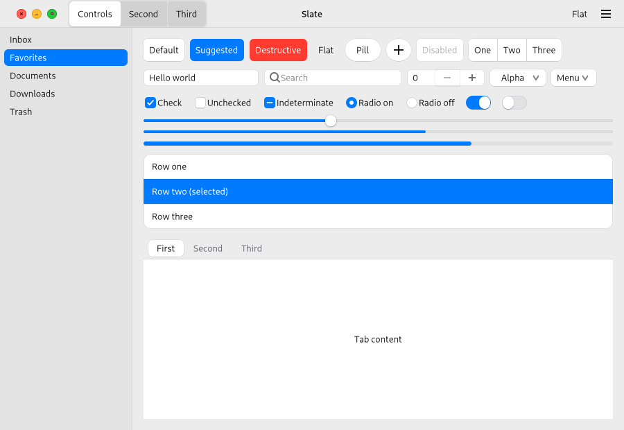
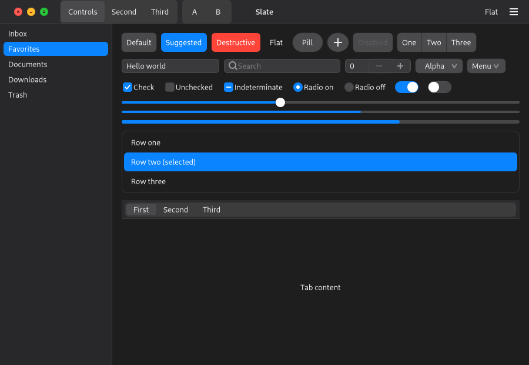
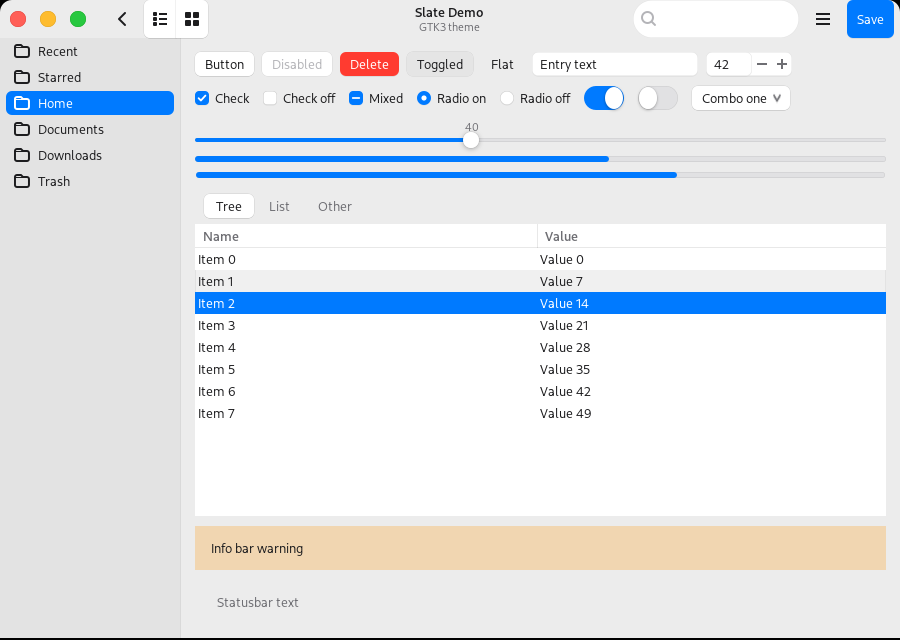
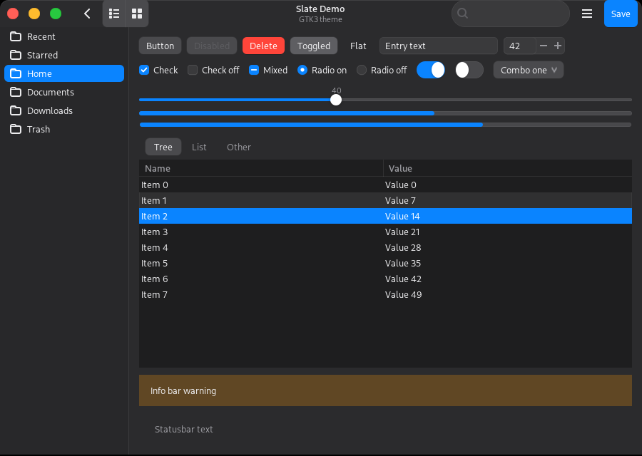
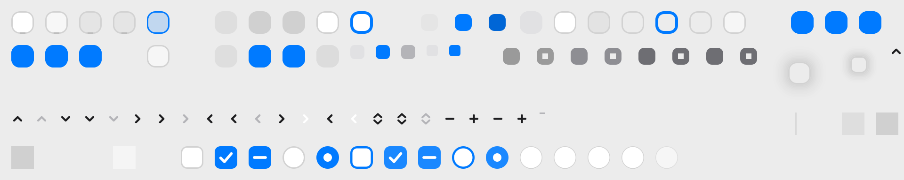
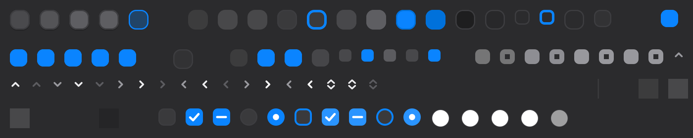

# Slate

A compact, modern macOS look for Linux. One set of design tokens produces a
GTK theme (GNOME) and a KDE Plasma theme that look the same: unified title
bars, traffic-light window buttons, slightly rounded corners, calm motion.
Made first for CachyOS, in a KDE Plasma edition and a GNOME edition.

Two variants: **Slate-Light** and **Slate-Dark**.

## How it is built

```
tokens.json  ->  build.py  ->  src/**/*.in templates  ->  dist/Slate-Light, dist/Slate-Dark
(colors, radii,    (fills {{token}}                      (what install.sh copies
 sizes, motion)     and __NAME__)                         into your home folder)
```

Every color, radius and size lives in `tokens.json`. Templates in `src/` use
`{{token}}` placeholders. `build.py` renders them once per variant, so GTK and
KDE can never drift apart.

## Layout

```
tokens.json              design values (single source of truth)
build.py                 renders src/ into dist/
install.sh               build + install, apply, uninstall
src/
  index.theme.in         GTK theme index
  gtk-3.0/               GTK3 theme
  gtk-4.0/               GTK4 and libadwaita theme
  kde/
    kvantum/             Qt widget style (Kvantum)
    aurorae/             KWin window decoration
    color-schemes/       KDE color scheme
    plasma/desktoptheme/ Plasma panel, widgets, popups
    look-and-feel/       one-click global theme
scripts/
  apply-kde.sh           switch Plasma to Slate
  preview.sh             screenshot the GTK demos (needs xvfb-run, imagemagick)
  demo-gtk3.py           GTK3 widget gallery
  demo-gtk4.py           GTK4 widget gallery
preview/                 screenshots
dist/                    build output (ignored by git)
```

## Requirements

- Python 3 (for `build.py`)
- Qt apps: `sudo pacman -S kvantum`
- Recommended font: `sudo pacman -S inter-font`

## Install

```sh
./install.sh                # build and install both variants
./install.sh --apply dark   # also switch to Slate-Dark (or: light)
./install.sh --uninstall    # remove Slate and restore your old settings
```

No sudo. Files go to `~/.themes`, `~/.local/share/themes`, `~/.config/Kvantum`,
`~/.local/share/{aurorae,color-schemes,plasma}`. `--apply` also writes the GTK
settings files, copies the theme to `~/.config/gtk-4.0` for libadwaita apps,
and sets gsettings (GNOME) or runs `scripts/apply-kde.sh` (KDE). Existing files
are saved as `*.bak-slate` and restored by `--uninstall`.

`--prefix DIR` installs into `DIR` instead of `$HOME`, for testing.

## What each part covers

| Part | Covers |
| --- | --- |
| `gtk-3.0` | GTK3 apps, window buttons, headerbars, menus, controls |
| `gtk-4.0` | GTK4 apps and libadwaita apps (through `~/.config/gtk-4.0`) |
| Kvantum | Qt5 and Qt6 widgets (buttons, menus, scrollbars, tabs) |
| Aurorae | KWin title bars with traffic lights |
| Color scheme | KDE colors for apps that ignore Kvantum |
| Plasma desktop theme | Panel, task manager, popups, widgets |
| Look and feel | Global theme that applies all of the above |

## Preview

| | Light | Dark |
| --- | --- | --- |
| GTK4 |  |  |
| GTK3 |  |  |
| Aurorae |  |  |
| Plasma |  |  |
| Kvantum |  |  |

`scripts/preview.sh` renders the GTK demos to `preview/demo-gtk3-<mode>.png`
and `preview/demo-gtk4-<mode>.png`.

## Change the accent or radius

Edit `tokens.json` (for example `accent`, `radius_window`, `radius_control`),
then run `./install.sh` again. Add `--apply light` or `--apply dark` to switch
to the rebuilt theme.

## License

GPLv2, see `COPYING`.
